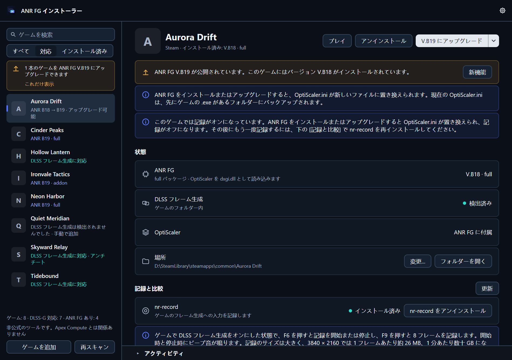
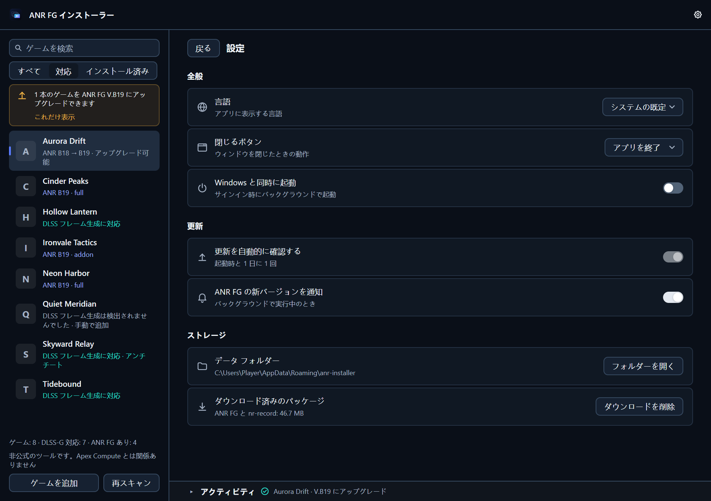

# ANR FG Installer

[English](README.md) | [简体中文](README.zh-CN.md) | 日本語

ゲームに [ANR FG](https://github.com/apex-compute/ANR) (Apex Neural Rendering のフレーム生成) をインストール、
アップグレード、アンインストールします。Steam のゲームを見つけて DLSS フレーム生成に対応したゲームを示し、適切な
パッケージに付属のインストーラーを実行します。

> [!NOTE]
> 非公式のコミュニティ ツールで、Apex Compute が作成、サポートしているものではありません。インストールされるのは
> ANR FG の [リリース パッケージ](https://github.com/apex-compute/ANR/releases) で、内容は変更されません。ANR FG
> 自体の問題は [apex-compute/ANR](https://github.com/apex-compute/ANR/issues) に、このインストーラーの問題は
> [こちら](https://github.com/JohnsonRan/anr-installer/issues) にお知らせください。

## 機能

- **ゲームを見つける**: すべての Steam ライブラリを調べ、DLSS フレーム生成に対応したゲームを示します。Steam 以外の
  ゲームはフォルダーを指定して追加できます。
- **適切なパッケージをインストール**: full または add-on、V.B04 以降の任意のバージョンを、SHA-256 で確認してから
  インストールします。アップグレード、再インストール、ダウングレード、アンインストールも同じページで行えます。
- **設定を守る**: `OptiScaler.ini` と `nr_fg.ini` が失われる操作の前に、ゲームの `.exe` と同じフォルダーへ
  バックアップします。
- **新しいバージョンを知らせる**: アップグレードできるゲームに印が付き、[すべて更新] でまとめてアップグレード
  できます。アンチチートのあるゲームは除きます。
- **記録と比較**: [nr-record](#記録と比較) の記録を ANR FG と DLSS-G で再生し、2 本のビデオを並べて表示します。
- **アンチチートの警告**: アンチチートのあるゲームにインストールする前に確認します。
- English、简体中文、繁體中文、日本語に対応しています。

## インストール

Windows 10 または 11 (x64)、
[Visual C++ v14 Redistributable (x64)](https://aka.ms/vc14/vc_redist.x64.exe)、ANR FG に対応した
GPU (NVIDIA RTX 20 以降または GTX 16、AMD Radeon RX 5000 以降、Intel Arc) が必要です。

| バージョン | 方法 |
| --- | --- |
| インストーラー | [最新のリリース](https://github.com/JohnsonRan/anr-installer/releases/latest) から `anr-fg-installer-setup-<バージョン>-amd64.exe` をダウンロードして実行します。管理者権限は必要ありません。 |
| PowerShell | `irm https://github.com/JohnsonRan/anr-installer/releases/latest/download/install.ps1 \| iex` |
| ポータブル版 | `anr-fg-installer-<バージョン>-windows-amd64-portable.zip` を展開して `ANR FG Installer.exe` を実行します。設定とダウンロードしたファイルはそのフォルダーに保存されます。 |

アプリにはコード署名がありません。SmartScreen の警告が表示された場合は、[詳細情報]、[実行] の順に選んでください。
アプリは自動で更新されます。Linux と Steam Deck (Proton) に対応するコードはありますが、まだテストされていません。

## かんたんな使い方

1. ゲームを終了します。
2. ANR FG Installer を起動して、左側でゲームを選びます。
3. ゲームのページ上部にある [インストール] を選びます。ANR FG がすでにある場合、ボタンは [アップグレード]、
   [再インストール]、[ダウングレード] のいずれかになります。横の矢印で別のバージョンを選べます。
4. ゲームを起動して、フレーム生成をオンにします。複数の選択肢がある場合は、NVIDIA のものを選びます。

インストールの各手順は、下部のアクティビティ ログに表示されます。[アンインストール] を選ぶと、パッケージが
バックアップしたファイルが元に戻ります。

## 設定

タイトル バーの歯車のボタンで開きます。

| 設定 | 既定 | 内容 |
| --- | --- | --- |
| 言語 | システムの既定 | English、简体中文、繁體中文、日本語 |
| 閉じるボタン | アプリを終了 | 通知領域に最小化することもできます |
| Windows と同時に起動 | オフ | サインイン時にバックグラウンドで起動します |
| 更新を自動的に確認する | オン | インストーラー自体の更新を、起動時と 1 日に 1 回確認します |
| ANR FG の新バージョンを通知 | オン | ウィンドウが非表示のとき、Windows の通知で知らせます |
| ダウンロードを削除 | | ダウンロードしたパッケージを削除します。必要になると再びダウンロードされます |

## 記録と比較

[nr-record](https://github.com/apex-compute/ANR#record-and-compare-frame-generation) は、ゲームがフレーム生成に
渡す入力を記録します。同じフレームで ANR FG と DLSS-G を比較できます。ゲームに ANR FG の full パッケージと
FFmpeg (インストーラーが [Scoop](https://scoop.sh) でインストールできます) が必要です。DLSS-G での再生には RTX 40
または 50 シリーズの GPU が必要です。

![記録があるゲームの [記録と比較] セクション](docs/images/record.ja.png)

1. [nr-record をインストール] を選び、ゲームを起動して DLSS フレーム生成をオンにします。F6 キーで記録を開始または
   停止し、F9 キーで 8 フレームを記録します。
2. インストーラーに戻って [更新] を選び、記録の [DLSS-G と比較] を選びます。
3. 2 本のビデオを同時に再生し、分割線で比べたり、左右に並べたりできます。1 つのフレームを正確に比べるには、その
   フレームで一時停止して [静止画] をエクスポートします。ロスレスの PNG 画像です。

再生には時間がかかります。3840 × 2160 では記録 1 秒につき約 1 分かかるため、ボタンでは最初の 5 秒を比較します。
ANR FG をもう一度インストールすると記録はオフになるので、その後で nr-record をもう一度インストールしてください。

## アンチチート

OptiScaler と ANR FG はゲームの描画に介入するため、アンチチートがチートと判断してアカウントを停止する場合が
あります。特にオンライン モードでは注意してください。インストーラーはアンチチートのあるゲームに印を付け、
インストールの前に確認します。リスクはご自身の責任となります。

## その他

- [動作のしくみ](docs/how-it-works.md) (英語): インストーラーが読み取り、変更する内容と、保存するファイル
- [開発者向けドキュメント](docs/development.md) (英語): ソースからのビルド、チェック、リリース
- [変更履歴](CHANGELOG.md) (英語)

## ライセンス

[MIT](LICENSE)。ANR FG と OptiScaler には、それぞれのライセンスが適用されます。
