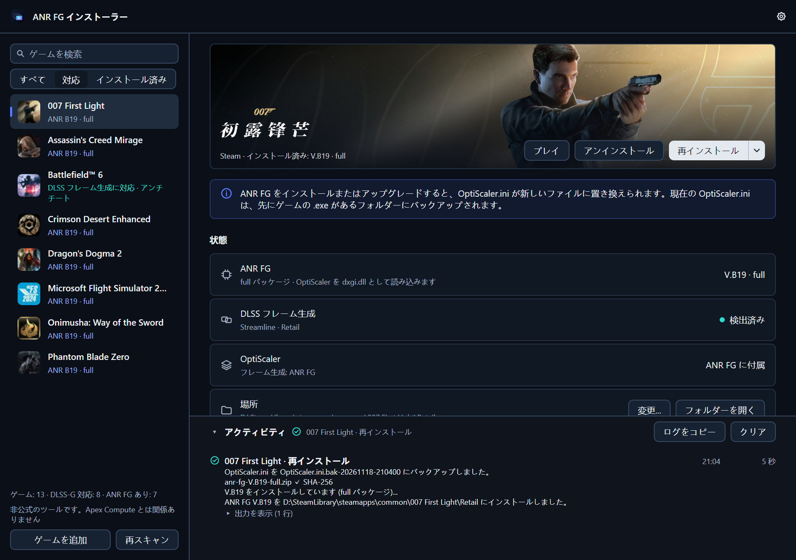

# ANR FG Installer

[English](README.md) | [简体中文](README.zh-CN.md) | 日本語

ANR FG Installer は、ゲームに [ANR FG](https://github.com/apex-compute/ANR) (Apex Neural Rendering のフレーム生成) を
インストール、アップグレード、ダウングレード、アンインストールするツールです。Steam のゲームを見つけて DLSS
フレーム生成に対応したゲームを示し、適切なパッケージを選んで、パッケージに付属のインストーラーを実行します。

> **非公式のツールです。** ANR FG の開発元である Apex Compute が作成、承認、サポートしているものではありません。
> インストールされるのは [apex-compute/ANR のリリース](https://github.com/apex-compute/ANR/releases) にある
> ANR FG のパッケージで、内容は変更されません。ANR FG 自体の問題は
> [apex-compute/ANR](https://github.com/apex-compute/ANR/issues) に、このインストーラーの問題は
> [JohnsonRan/anr-installer](https://github.com/JohnsonRan/anr-installer/issues) にお知らせください。


## 動作環境

- Windows 10 または 11 (x64)
- Microsoft Visual C++ 2015-2022 Redistributable (x64)。OptiScaler に必要です。
- ANR FG に対応した GPU: NVIDIA GeForce RTX 20 以降または GTX 16、AMD Radeon RX 5000 以降、Intel Arc A と B

Linux と Steam Deck (Proton) に対応するコードはありますが、まだテストされていません。

## 入手方法

[最新のリリース](https://github.com/JohnsonRan/anr-installer/releases/latest) から
`anr-fg-installer-setup-<バージョン>-amd64.exe` をダウンロードして実行します。アプリは現在の Windows アカウントにだけ
`%LOCALAPPDATA%\Programs\ANR FG Installer` にインストールされ、管理者権限は必要ありません。PowerShell からも
インストールできます:

```
irm https://github.com/JohnsonRan/anr-installer/releases/latest/download/install.ps1 | iex
```

ポータブル版の `anr-fg-installer-<バージョン>-windows-amd64-portable.zip` はインストール不要です。`ANR FG Installer`
フォルダーを書き込みできる場所に展開して、`ANR FG Installer.exe` を実行します。設定とダウンロードしたファイルは、
そのフォルダーに保存されます。

アプリとインストーラーにはコード署名がないため、初回の実行時に Windows SmartScreen の警告が表示される場合があります。
[詳細情報] を選び、[実行] を選んでください。

アプリは自動で更新されます。起動時と 1 日に 1 回、新しいバージョンが確認され、タイトル バーのバージョンのボタンを
選ぶとすぐに確認されます。インストールされるのは、このプロジェクトの鍵で署名された更新だけです。ソースからビルドする
場合は、[開発者向けドキュメント](docs/development.md) (英語) をご覧ください。

## 使い方

1. ゲームを終了します。
2. ANR FG Installer を起動して、左側でゲームを選びます。[対応] には、DLSS フレーム生成に対応した
   ゲームが表示されます。Steam 以外のゲームは、[ゲームを追加] からフォルダーを指定して追加します。
3. ゲームのページ上部にある [インストール] を選びます。ANR FG がすでにインストールされている場合、
   ボタンは横の矢印で選んだバージョンに応じて [アップグレード]、[再インストール]、[ダウングレード] になります。
4. ゲームを起動して、フレーム生成をオンにします。複数の選択肢がある場合は、NVIDIA のものを選びます。

[アンインストール] を実行すると、パッケージのインストーラーがバックアップしたファイルが元に戻されます。
設定ファイルが失われる操作の前には、そのファイルがゲームの `.exe` と同じフォルダーに `<名前>.bak-<日時>` として
コピーされます。full パッケージが `OptiScaler.ini` を置き換える前と、アンインストールやダウングレードで
`nr_fg.ini` が削除される前です。



ANR FG の新しいバージョンが公開され、古いバージョンが入っているゲームがある場合は、リリース ノートが 1 回表示されます。
そこで [すべて更新] を選ぶと、それらのゲームが順番にアップグレードされます。パッケージの種類はそれぞれ
そのままです。アンチチートのあるゲームは対象外なので、各ゲームのページから個別にアップグレードしてください。一覧では
アップグレードできるゲームに印が付き、一覧の上のバーからそれらだけを表示できます。

タイトル バーの歯車のボタンで [設定] を開けます。[言語] は既定ではシステムに合わせて表示され、English、
简体中文、繁體中文、日本語から選ぶこともできます。[閉じるボタン] は既定ではアプリを終了しますが、ウィンドウを
通知領域に格納するようにもできます。その場合、通知領域のアイコンでウィンドウを再び表示でき、アイコンのメニューから
終了できます。アプリの実行中にもう一度起動すると、開いているウィンドウが前面に表示されます。
[Windows と同時に起動] をオンにすると、サインイン時にアプリが起動します。閉じるボタンで通知領域に格納する設定の
場合はウィンドウが通知領域に隠れ、そうでない場合は最小化されます。インストール版をアンインストールすると、その
登録も削除されます。ポータブル版の登録は残ります。ポータブル版は実行しているパスを登録するため、
フォルダーを移動するとこの設定はオフと表示されます。もう一度オンにしてください。[ANR FG の新バージョンを通知] は
既定でオンです。ウィンドウが非表示か最小化されているとき、ANR FG の新しいリリースごとに 1 回、Windows の通知が
表示されます。新しいリリースは起動時と 6 時間ごとに確認されます。[更新を自動的に確認する] では、インストーラー
自体の更新を自動で確認するかどうかを切り替えます。[データ フォルダー] では、設定を保存するフォルダーを開きます。
[ダウンロードを削除] では、ダウンロードした ANR FG と nr-record のパッケージを削除します。これらは必要になったときに
再びダウンロードされます。


インストールなどのタスクの実行中にウィンドウを閉じるかアプリを終了しようとすると、確認が表示されます。終了すると
タスクが完了せず、ゲームのファイルが変更の途中のまま残る可能性があります。

## 記録と比較

[nr-record](https://github.com/apex-compute/ANR#record-and-compare-frame-generation) は ANR FG と同じリリースで
配布されており、ゲームがフレーム生成に渡す入力を記録します。同じフレームで ANR FG と DLSS-G を比較できます。
ANR FG の full パッケージをインストールしたゲームのページには、[記録と比較] が表示されます。

![記録があるゲームの [記録と比較] セクション](docs/images/record.ja.png)

1. [nr-record をインストール] をクリックします。ゲームを起動して、DLSS フレーム生成を
   オンにします。F6 で記録を開始および停止し、F9 で 8 フレームを記録します。
2. ANR FG Installer に戻って、[更新] をクリックします。そのゲームの記録ごとに
   [DLSS-G と比較] が表示されます。クリックすると、インストール済みの ANR FG と
   ゲーム付属の `nvngx_dlssg.dll` で記録が再生され、2 本のビデオがウィンドウに表示されます。
   DLSS-G での再生には、NVIDIA RTX 40 または 50 シリーズの GPU が必要です。
3. 比較ページでは、2 本のビデオを同時に再生したり、境界線をドラッグしたり、左右に並べたりできます。
   ビデオは圧縮されており、フレーム単位では同期されません。フレームを正確に比較するには、そのフレームで
   一時停止してから [静止画] を選びます。前後のフレームがロスレスの PNG 画像としてエクスポートされます。
   [nr-record のビューアーで開く] を選ぶと、同じ比較がビューアーで開き、
   ピクセル単位の拡大、マーク、エクスポートを利用できます。

記録はサイズが大きく、再生にも時間がかかります。3840 × 2160 では 1 フレームあたり約 26 MB になり、記録 1 秒分の
再生に約 1 分かかります。そのため、ボタンでは記録の最初の 5 秒だけが比較されます。横の矢印からは、最初の
15 秒または全体を再生したり、記録を削除したりできます。

ビデオの作成には FFmpeg と FFprobe が必要です。見つからない場合は、[Scoop でインストール]
でインストールできます。[Scoop](https://scoop.sh) がない場合は、先に Scoop をインストールするよう案内されます。
ANR FG を再インストールすると、フレーム生成は ANR FG に戻ります。記録を続けるには、nr-record をもう一度
インストールしてください。アップスケーラーの入力の記録も一覧に表示されますが、再生できるのはコマンド ラインからのみです。

## アンチチート

OptiScaler と ANR FG は、ゲームの描画処理に組み込まれます。アンチチートがこれらを不正なツールと判断して、
アカウントを停止する場合があります。特にオンライン モードではご注意ください。ゲームにアンチチート
(Easy Anti-Cheat、EA Javelin、BattlEye など) が含まれている場合、そのゲームには印が付き、インストールの前に
確認のダイアログ ボックスが表示されます。このリスクを受け入れられる場合にのみ、インストールしてください。
リスクはご自身で負うことになります。

## 動作のしくみ

[動作のしくみ](docs/how-it-works.md) (英語) では、インストーラーが読み取る内容と変更する内容、パッケージを
ダウンロードせずにインストール済みのバージョンを判別する方法、保存されるファイルについて説明しています。

## ライセンス

[MIT](LICENSE)。インストーラーがダウンロードしてインストールする ANR FG と OptiScaler には、それぞれのライセンスが
適用されます。
