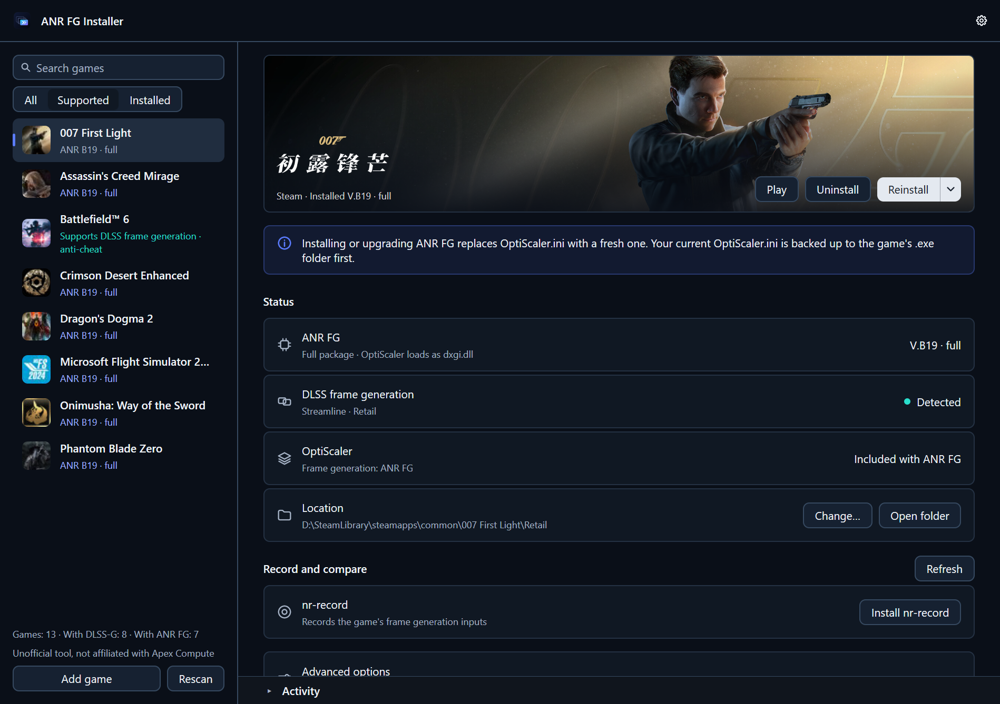
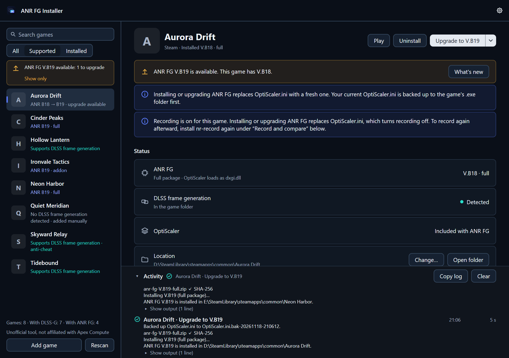
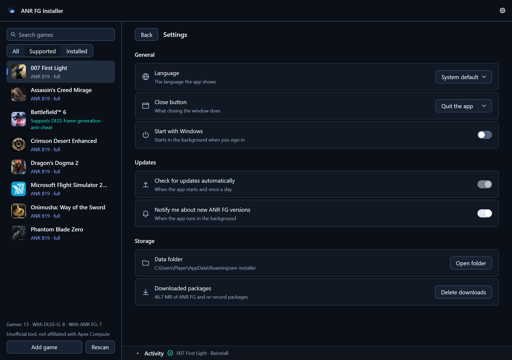
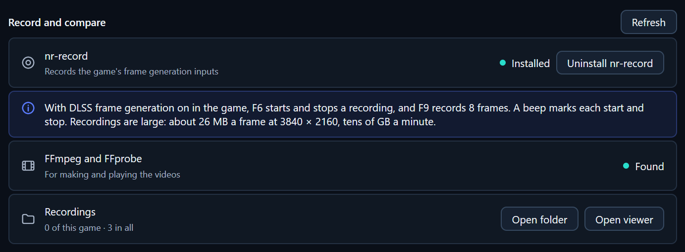

# ANR FG Installer

English | [简体中文](README.zh-CN.md) | [日本語](README.ja.md)

Install, upgrade and remove [ANR FG](https://github.com/apex-compute/ANR) (Apex Neural Rendering frame
generation) in your games. It finds your Steam games, tells which ship DLSS frame generation, and runs the right
package's own installer.

> [!NOTE]
> An unofficial community tool, not made or supported by Apex Compute. It installs ANR FG's own
> [release packages](https://github.com/apex-compute/ANR/releases), unchanged. Report problems with ANR FG to
> [apex-compute/ANR](https://github.com/apex-compute/ANR/issues), and problems with this installer
> [here](https://github.com/JohnsonRan/anr-installer/issues).

## Features

- **Finds your games**: every Steam library, and which games ship DLSS frame generation. Add games from other
  stores by their folder.
- **Installs the right package**: full or add-on, any release from V.B04 on, checked against its SHA-256 sums.
  Upgrade, reinstall, downgrade or uninstall from the same page.
- **Keeps your settings**: what you changed in `OptiScaler.ini` carries over to the new file. Where the new
  version changed the same setting, you choose, as in a merge conflict. `OptiScaler.ini` and `nr_fg.ini` are also
  backed up next to the game's `.exe`.
- **Tells you about new versions**: the list marks the games to upgrade, and **Update all** upgrades them in one
  go, except games with anti-cheat.
- **Records and compares**: replays an [nr-record](#record-and-compare) recording through ANR FG and DLSS-G and
  plays the two side by side.
- **Warns about anti-cheat** before installing into a game that ships it.
- English, Simplified Chinese, Traditional Chinese and Japanese.

## Install

Requires Windows 10 or 11 (x64), the
[Visual C++ v14 Redistributable (x64)](https://aka.ms/vc14/vc_redist.x64.exe), and a GPU that ANR
FG supports: NVIDIA RTX 20 and newer or GTX 16, AMD Radeon RX 5000 and newer, or Intel Arc.

| Version | How |
| --- | --- |
| Installer | Run `anr-fg-installer-setup-<version>-amd64.exe` from the [latest release](https://github.com/JohnsonRan/anr-installer/releases/latest). No administrator rights needed. |
| PowerShell | `irm https://github.com/JohnsonRan/anr-installer/releases/latest/download/install.ps1 \| iex` |
| Portable | Extract `anr-fg-installer-<version>-windows-amd64-portable.zip` and run `ANR FG Installer.exe`. Settings and downloads stay in its folder. |

The app is not code-signed: if SmartScreen warns, choose **More info**, then **Run anyway**. It updates itself.
Linux and the Steam Deck (Proton) are written for but not tested yet.

## Quick start

1. Close the game.
2. Open ANR FG Installer and choose the game on the left.
3. Select **Install** at the top of its page. If ANR FG is already there, the button reads **Upgrade**,
   **Reinstall** or **Downgrade**; the arrow beside it picks another version.
4. Start the game and turn on frame generation (the NVIDIA option, where the game offers several).

Each install shows its steps in the activity log at the bottom. **Uninstall** puts back what the package backed
up.

## Settings

The gear button in the title bar opens them.

| Setting | Default | What it does |
| --- | --- | --- |
| Language | System | English, Simplified Chinese, Traditional Chinese or Japanese |
| Close button | Quit the app | Or hide the window to the notification area |
| Start with Windows | Off | Starts the app, out of sight, when you sign in |
| Check for updates automatically | On | The installer's own updates, at launch and daily |
| Notify me about new ANR FG versions | On | A Windows notification while the window is hidden |
| Delete downloads | | Frees the downloaded packages; they download again when needed |

## Record and compare

[nr-record](https://github.com/apex-compute/ANR#record-and-compare-frame-generation) records what a game gives its
frame generation, so ANR FG and DLSS-G can be compared on the same frames. It needs ANR FG's full package in the
game, FFmpeg (the app installs it with [Scoop](https://scoop.sh)), and for the DLSS-G side an RTX 40 or 50 GPU.

1. Select **Install nr-record**, start the game and turn on DLSS frame generation. **F6** starts and stops a
   recording; **F9** records 8 frames.
2. Back in the installer, select **Refresh**, then **Compare with DLSS-G** on a recording.
3. Play the two videos together, with a divider or side by side. To compare one frame exactly, pause on it and
   export **Stills**, lossless PNG images.

Replays are slow, about a minute for each second recorded at 3840 × 2160, so the button compares the first 5
seconds. Installing ANR FG again turns recording off: install nr-record again afterwards.

## Anti-cheat

OptiScaler and ANR FG hook into a game's rendering, which anti-cheat may take for a cheat and ban the account for,
in online modes above all. The installer marks games that ship anti-cheat and asks before installing into them.
The risk is yours.

## More

- [How it works](docs/how-it-works.md): what the installer reads and changes, and the files it keeps.
- [Developing](docs/development.md): building from source, the checks and releasing.
- [Changelog](CHANGELOG.md)

## License

[MIT](LICENSE). ANR FG and OptiScaler keep their own licenses.
