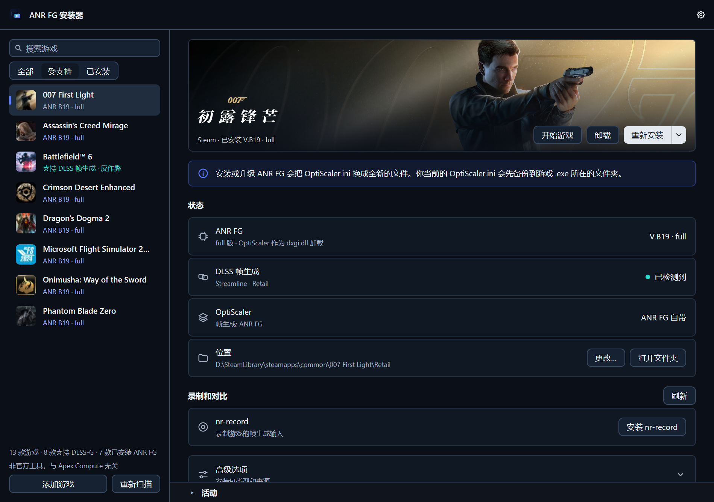
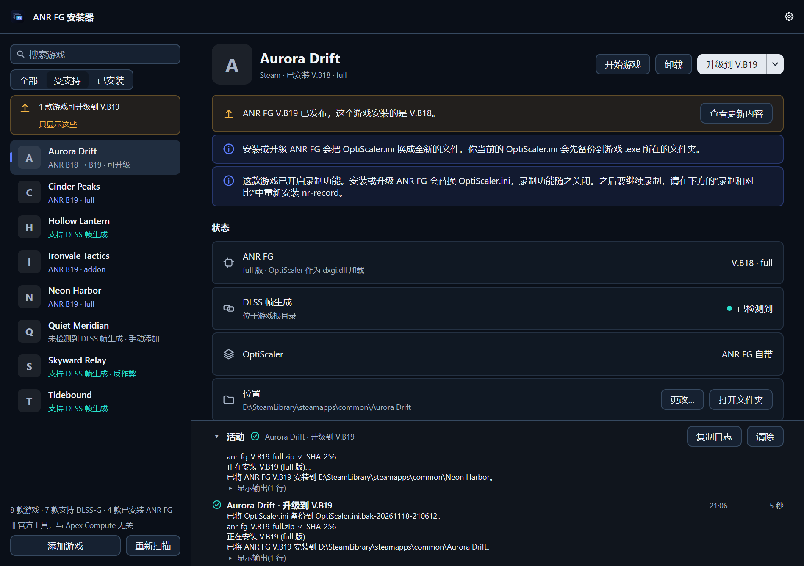
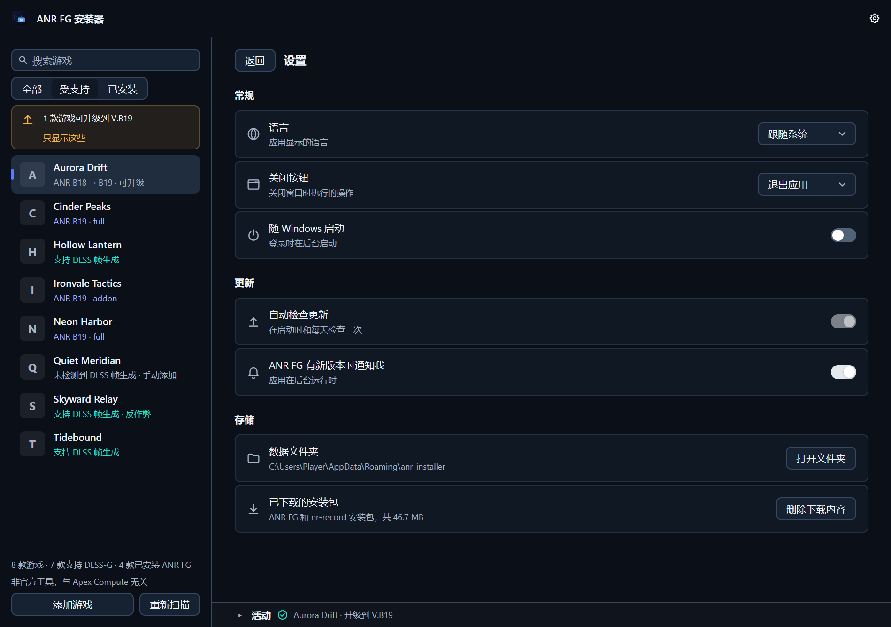

# ANR FG 安装器

[English](README.md) | 简体中文 | [日本語](README.ja.md)

在你的游戏中安装、升级和卸载 [ANR FG](https://github.com/apex-compute/ANR)（Apex Neural Rendering 帧生成）。
它会找到你的 Steam 游戏，标出哪些支持 DLSS 帧生成，并调用合适安装包自带的安装程序。

> [!NOTE]
> 非官方社区工具，并非由 Apex Compute 制作或提供支持。它安装的是 ANR FG 未经修改的官方
> [发布包](https://github.com/apex-compute/ANR/releases)。ANR FG 本身的问题请反馈到
> [apex-compute/ANR](https://github.com/apex-compute/ANR/issues)，安装器的问题请反馈到
> [这里](https://github.com/JohnsonRan/anr-installer/issues)。

## 功能

- **找到你的游戏**：扫描所有 Steam 库，标出支持 DLSS 帧生成的游戏。其他平台的游戏可以按文件夹添加。
- **安装合适的安装包**：full 版或 addon 版，V.B04 及之后的任一版本，下载后校验 SHA-256。升级、重新安装、降级和卸载都在
  同一个页面完成。
- **保留你的设置**：在某一步会丢失 `OptiScaler.ini` 或 `nr_fg.ini` 之前，先把它备份到游戏 `.exe` 所在的文件夹。
- **新版本提醒**：列表会标出可升级的游戏，“全部更新”可以一次升级完，带反作弊的游戏除外。
- **录制和对比**：通过 ANR FG 和 DLSS-G 分别回放 [nr-record](#录制和对比) 的录制内容，并排播放两段视频。
- **反作弊提醒**：安装到带反作弊的游戏之前会先询问。
- 支持 English、简体中文、繁體中文和日本語。

## 安装

需要 Windows 10 或 11 (x64)、
[Visual C++ v14 Redistributable (x64)](https://aka.ms/vc14/vc_redist.x64.exe)，以及 ANR FG
支持的显卡：NVIDIA RTX 20 及更新或 GTX 16 系列、AMD Radeon RX 5000 及更新，或 Intel Arc。

| 版本 | 方法 |
| --- | --- |
| 安装版 | 从[最新版本](https://github.com/JohnsonRan/anr-installer/releases/latest)下载并运行 `anr-fg-installer-setup-<版本>-amd64.exe`，不需要管理员权限。 |
| PowerShell | `irm https://github.com/JohnsonRan/anr-installer/releases/latest/download/install.ps1 \| iex` |
| 便携版 | 解压 `anr-fg-installer-<版本>-windows-amd64-portable.zip`，运行 `ANR FG Installer.exe`。设置和下载内容都保存在它的文件夹里。 |

程序没有代码签名：如果 SmartScreen 发出警告，请选择“更多信息”，再选择“仍要运行”。程序会自动更新。
Linux 和 Steam Deck (Proton) 的支持已经写好，但尚未测试。

## 快速上手

1. 关闭游戏。
2. 打开 ANR FG 安装器，在左侧选择游戏。
3. 选择游戏页面顶部的“安装”。如果已经装过 ANR FG，按钮会显示为“升级”“重新安装”或“降级”；旁边的箭头可以选择
   其他版本。
4. 启动游戏并打开帧生成（游戏提供多个选项时选 NVIDIA 的）。

每次安装的步骤都显示在底部的活动日志中。“卸载”会还原安装包备份的文件。

## 设置

选择标题栏上的齿轮按钮可以打开设置。

| 设置 | 默认值 | 作用 |
| --- | --- | --- |
| 语言 | 跟随系统 | English、简体中文、繁體中文或日本語 |
| 关闭按钮 | 退出应用 | 也可以改为最小化到托盘 |
| 随 Windows 启动 | 关闭 | 登录时在后台启动应用 |
| 自动检查更新 | 开启 | 安装器自身的更新，启动时和每天检查一次 |
| ANR FG 有新版本时通知我 | 开启 | 窗口隐藏时通过 Windows 通知提示 |
| 删除下载内容 | | 删除已下载的安装包，需要时会重新下载 |

## 录制和对比

[nr-record](https://github.com/apex-compute/ANR#record-and-compare-frame-generation) 用来录制游戏交给帧生成的输入，
这样就能用同样的帧对比 ANR FG 和 DLSS-G。它需要游戏装好 ANR FG 的 full 版，还需要 FFmpeg（安装器可以通过
[Scoop](https://scoop.sh) 安装）；通过 DLSS-G 回放需要 RTX 40 或 50 系列显卡。

1. 选择“安装 nr-record”，启动游戏并开启 DLSS 帧生成。按 F6 开始或停止录制，按 F9 录制 8 帧。
2. 回到安装器，选择“刷新”，然后在录制内容上选择“与 DLSS-G 对比”。
3. 同时播放两段视频，可以用分隔线对比，也可以并排显示。要精确对比某一帧，请暂停到这一帧并导出“静帧”，即无损
   PNG 图像。

回放很慢：3840 × 2160 下每秒录制内容大约需要回放一分钟，所以按钮默认只对比前 5 秒。重新安装 ANR FG 会关闭录制，
之后请重新安装 nr-record。

## 反作弊

OptiScaler 和 ANR FG 会接入游戏的渲染，反作弊可能把它们当作作弊程序并封禁账号，联机模式下尤其如此。安装器会标出
带反作弊的游戏，并在安装前询问。风险由你自行承担。

## 更多

- 《[工作原理](docs/how-it-works.md)》（英文）：安装器读取和修改哪些内容，以及它保存的文件。
- 《[开发说明](docs/development.md)》（英文）：从源码构建、检查和发布。
- [更新日志](CHANGELOG.md)（英文）

## 许可证

[MIT](LICENSE)。ANR FG 和 OptiScaler 各自适用其本身的许可证。
