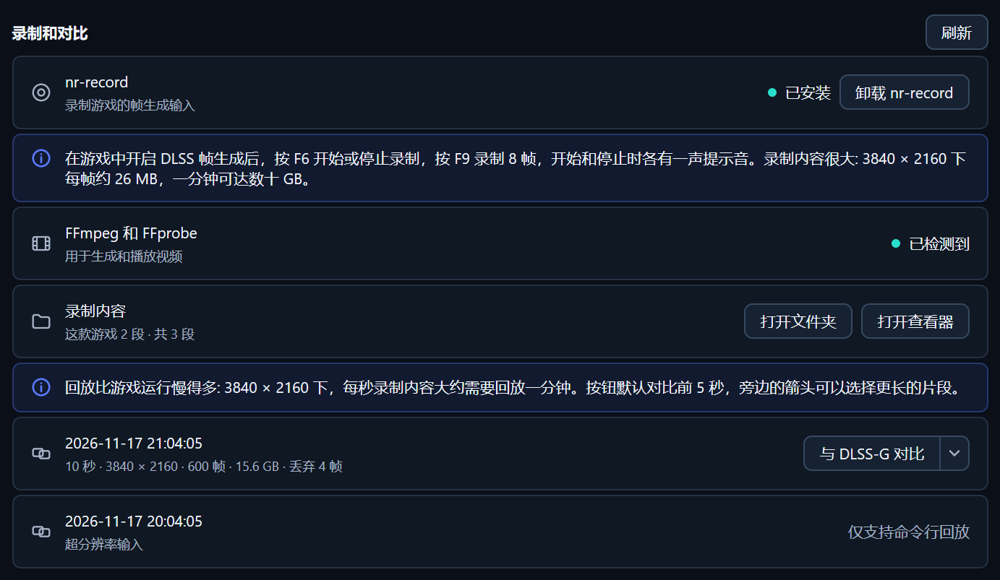

# ANR FG 安装器

[English](README.md) | 简体中文 | [日本語](README.ja.md)

ANR FG 安装器用来在你的游戏中安装、升级、降级和卸载 [ANR FG](https://github.com/apex-compute/ANR)
（Apex Neural Rendering 帧生成）。它会找到你的 Steam 游戏，标出哪些支持 DLSS 帧生成，选择合适的安装包，
并调用安装包自带的安装程序。

> **非官方工具。** 本项目是社区工具，并非由 ANR FG 的开发者 Apex Compute 制作、认可或提供支持。它安装的是
> [apex-compute/ANR 发布页](https://github.com/apex-compute/ANR/releases)上未经修改的官方安装包。ANR FG 本身的问题请反馈到
> [apex-compute/ANR](https://github.com/apex-compute/ANR/issues)，安装器的问题请反馈到
> [这里](https://github.com/JohnsonRan/anr-installer/issues)。


## 系统要求

- Windows 10 或 11 (x64)
- Microsoft Visual C++ 2015-2022 Redistributable (x64)，OptiScaler 需要它
- ANR FG 支持的显卡：NVIDIA GeForce RTX 20 及更新或 GTX 16 系列；AMD Radeon RX 5000 及更新；Intel Arc A 和
  B 系列

Linux 和 Steam Deck (Proton) 的支持已经写好，但尚未测试。

## 获取

从[最新版本](https://github.com/JohnsonRan/anr-installer/releases/latest)下载
`anr-fg-installer-setup-<版本>-amd64.exe` 并运行。它只为当前 Windows 账户安装，位置是
`%LOCALAPPDATA%\Programs\ANR FG Installer`，不需要管理员权限。也可以在 PowerShell 中安装：

```
irm https://github.com/JohnsonRan/anr-installer/releases/latest/download/install.ps1 | iex
```

便携版 `anr-fg-installer-<版本>-windows-amd64-portable.zip` 无需安装：把其中的 `ANR FG Installer` 文件夹解压到可写入的位置，
运行 `ANR FG Installer.exe` 即可。它会把设置和下载的文件保存在这个文件夹里。

程序和安装程序都没有代码签名，首次运行时 Windows SmartScreen 可能会发出警告：选择“更多信息”，再选择“仍要运行”。

程序会自动更新：启动时和之后每天检查一次新版本，选择标题栏上的版本号按钮可以立即检查。它只安装用本项目密钥签名的更新。
如果想从源码构建，请参阅《[开发说明](docs/development.md)》（英文）。

## 使用

1. 关闭游戏。
2. 打开 ANR FG 安装器，在左侧选择游戏。“受支持”列出带有 DLSS 帧生成的游戏。要添加其他平台的游戏，请选择
   “添加游戏”，然后选择游戏文件夹。
3. 选择游戏页面顶部的“安装”。如果已经装过 ANR FG，按钮会根据旁边箭头菜单中选择的版本显示为“升级”“重新安装”
   或“降级”。
4. 进入游戏，打开帧生成（游戏提供多个选项时选 NVIDIA 的）。

“卸载”会还原安装程序备份的文件。在某一步会丢失你的配置文件之前，安装器会先把它复制到游戏 `.exe` 所在文件夹，
命名为 `<文件名>.bak-<时间>`：full 版替换 `OptiScaler.ini` 之前备份它，卸载或降级删除 `nr_fg.ini` 之前备份它。


ANR FG 发布新版本、而你有游戏装的是旧版本时，安装器会显示一次发行说明。选择其中的“全部更新”，会按顺序升级这些
游戏，各自保持原来的安装包类型。带反作弊的游戏不会一并更新，请在各自的页面中单独升级。列表会标出可升级的游戏，
列表上方的提示条可以只显示这些游戏。

选择标题栏上的齿轮按钮可以打开“设置”。“语言”默认跟随系统，也可以选择 English、简体中文、繁體中文或日本語。“关闭按钮”默认退出应用，
也可以改为把窗口最小化到托盘：点击托盘图标可以重新打开窗口，图标的菜单可以退出应用。应用已在运行时再次启动它，
会切换到已打开的窗口。“随 Windows 启动”会在你登录时启动应用：如果关闭按钮设为最小化到托盘，窗口隐藏在托盘中，
否则最小化。卸载安装版会删除它登记的这一项，便携版登记的项会保留。
便携版登记的是它运行时所在的路径：移动文件夹后，这项设置会显示为关闭，重新打开即可。
“ANR FG 有新版本时通知我”默认开启：窗口隐藏或最小化时，每个 ANR FG 新版本会通过 Windows 通知提示一次；
应用在启动时和之后每 6 小时检查一次。“自动检查更新”控制安装器自身是否自动检查更新。“数据文件夹”打开保存设置的文件夹。
“删除下载内容”会删除已下载的 ANR FG 和 nr-record 安装包，需要时会重新下载。


在安装等任务进行中关闭窗口或退出应用时，会先询问：退出可能让任务无法完成，游戏文件只更改了一半。

## 录制和对比

[nr-record](https://github.com/apex-compute/ANR#record-and-compare-frame-generation) 和 ANR FG 在同一处发布，
用来录制游戏交给帧生成的输入，这样就能用同样的帧对比 ANR FG 和 DLSS-G。游戏装好 ANR FG 的 full 版后，
它的页面上会出现“录制和对比”。



1. 选择“安装 nr-record”，然后启动游戏并开启 DLSS 帧生成。按 F6 开始或停止录制，按 F9 录制 8 帧。
2. 回到安装器，选择“刷新”。这款游戏的每段录制内容都有“与 DLSS-G 对比”：安装器会分别通过已安装的 ANR FG
   和游戏自带的 `nvngx_dlssg.dll` 回放这段录制内容，然后在窗口中显示两段视频。通过 DLSS-G 回放需要
   NVIDIA RTX 40 或 50 系列显卡。
3. 在对比页面中，可以同时播放两段视频、拖动两者之间的分隔线，或者让它们并排显示。视频经过压缩，也不是
   逐帧锁定的：要精确对比某一帧，请暂停到这一帧，然后选择“静帧”，安装器会把它前后的画面导出为无损 PNG
   图像。“在 nr-record 查看器中打开”会在那里打开同一组对比，可以按像素缩放、添加标记和导出。

录制内容很大，回放也很慢：3840 × 2160 下每帧约 26 MB，每秒录制内容大约需要回放一分钟。因此按钮默认只对比
录制内容的前 5 秒；旁边的箭头可以选择对比前 15 秒或整段，也可以删除这段录制内容。

生成视频需要 FFmpeg 和 FFprobe。未检测到时，可以选择“通过 Scoop 安装”；如果没有安装
[Scoop](https://scoop.sh)，安装器会提示你先安装 Scoop。重新安装 ANR FG 后，帧生成会切换回 ANR FG；
要继续录制，请重新安装 nr-record。超分辨率输入的录制内容也会列出，但只能在命令行中回放。

## 反作弊

OptiScaler 和 ANR FG 会接入游戏的渲染。反作弊可能把它们当作作弊程序并封禁账号，联机模式下尤其如此。
游戏带有反作弊（Easy Anti-Cheat、EA Javelin、BattlEye 等）时，安装器会标出来并在安装前询问。只有在你
接受这个风险时才安装，风险由你自行承担。

## 工作原理

《[工作原理](docs/how-it-works.md)》（英文）介绍安装器读取和修改哪些内容、如何在不下载的情况下识别已装版本，
以及它保存的文件。

## 许可证

[MIT](LICENSE)。安装器下载并安装的 ANR FG 和 OptiScaler 各自适用其本身的许可证。
